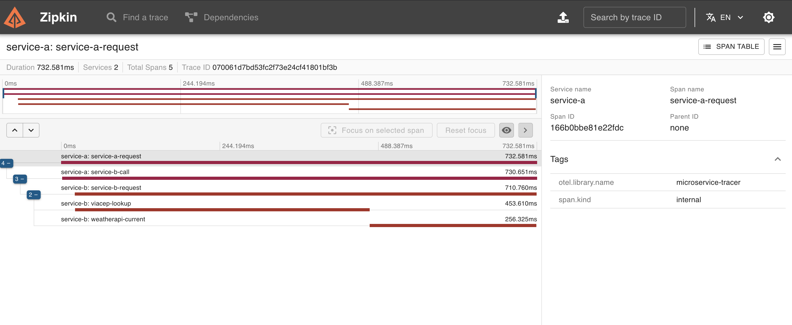

# Climate ZIP Code — Observabilidade distribuída

Projeto composto por dois serviços Go:

- **Serviço A** (`localhost:8080`): recebe um CEP por `POST /weather` e orquestra a consulta.
- **Serviço B** (`localhost:8081`): consulta o CEP no ViaCEP, obtém a temperatura atual na WeatherAPI e retorna os valores em Celsius, Fahrenheit e Kelvin.

O rastreamento distribuído é instrumentado com **OpenTelemetry**. Os serviços enviam os traces por OTLP/gRPC ao OpenTelemetry Collector, que os encaminha ao **Zipkin**.

## Pré-requisitos

- Docker e Docker Compose instalados.
- Acesso à internet para baixar as imagens e para as consultas externas feitas pelos serviços.

## 1. Subir a aplicação

Na raiz do projeto (diretório que contém `docker-compose.yaml`), execute:

```bash
docker compose up --build
```

O Compose inicia os seguintes componentes:

| Componente | Endereço local |
|---|---|
| Serviço A | http://localhost:8080 |
| Serviço B | http://localhost:8081 |
| Swagger do Serviço A | http://localhost:8080/swagger/index.html |
| Swagger do Serviço B | http://localhost:8081/swagger/index.html |
| Zipkin | http://localhost:9411 |

Aguarde os containers iniciarem antes de enviar a requisição.

> **Chave da WeatherAPI:** o `docker-compose.yaml` define `WEATHER_API_KEY` para os serviços. Para utilizar uma chave própria, substitua o valor configurado no Compose por uma chave válida da WeatherAPI. Evite versionar chaves reais no repositório.

## 2. Realizar uma requisição POST no Serviço A

O Serviço A recebe um objeto JSON com a propriedade `cep`. O CEP deve ser informado como **string com exatamente 8 dígitos**.

### cURL

Execute no terminal:

```bash
curl -i -X POST http://localhost:8080/weather \
  -H "Content-Type: application/json" \
  -H "Accept: application/json" \
  -d '{"cep":"01001001"}'
```

Também é possível utilizar outro CEP válido, por exemplo `01001000`.

### Arquivo `api.http` (VS Code / JetBrains)

Na raiz do projeto existe o arquivo `api.http`, que contém a requisição pronta para execução:

```http
POST /weather HTTP/1.1
Host: localhost:8080
Accept: application/json
Content-Type: application/json

{
  "cep": "01001001"
}
```

Abra o arquivo em uma IDE com suporte a arquivos HTTP (por exemplo, a extensão REST Client do VS Code) e clique em **Send Request** acima da requisição.

### Resposta esperada

Em caso de sucesso, o Serviço A responde com HTTP `200 OK` e um JSON com a cidade e as temperaturas:

```json
{
  "city": "São Paulo",
  "temp_C": 25.0,
  "temp_F": 77.0,
  "temp_K": 298.0
}
```

### Fórmulas de conversão

A WeatherAPI retorna a temperatura em Celsius, e o Serviço B calcula as demais:

- Celsius para Fahrenheit: `F = C × 1.8 + 32`
- Celsius para Kelvin: `K = C + 273`

Os valores acima são apenas ilustrativos: a cidade e a temperatura dependem do CEP consultado e dos dados atuais retornados pelos serviços externos.

Possíveis respostas de erro do Serviço A:

| HTTP | Significado |
|---|---|
| `400 Bad Request` | Corpo JSON inválido ou com campos não reconhecidos. |
| `404 Not Found` | CEP não encontrado. |
| `422 Unprocessable Entity` | CEP ausente, fora do formato ou diferente de uma string de 8 dígitos. |
| `500 Internal Server Error` | Falha interna ou erro em um serviço dependente. |

## 3. Visualizar os traces no Zipkin

1. Com os containers em execução, acesse **[http://localhost:9411](http://localhost:9411)**.
2. Envie uma requisição `POST /weather` ao Serviço A conforme a seção anterior.
3. No Zipkin, atualize a tela e clique em **Run Query** para buscar os traces recentes (ou ajuste o intervalo de tempo da busca).
4. Abra um trace para visualizar sua linha do tempo, duração e spans.

A chamada percorre o fluxo:

```text
Cliente
  |
  | POST /weather
  v
Serviço A
  |
  | GET /weather/{cep}
  v
Serviço B
  |
  +--> ViaCEP
  |
  +--> WeatherAPI
```

O Serviço A cria o span `service-a-request` e, ao chamar o Serviço B, abre o span `service-b-call` e propaga o contexto de trace no header `traceparent`. O Serviço B extrai esse contexto, cria o span `service-b-request` e abre um span filho para cada dependência externa: `viacep-lookup` e `weatherapi-current`. Assim, todos os spans dos dois serviços ficam associados ao mesmo trace.

No Zipkin, procure os serviços **`service-a`** e **`service-b`**. A visualização do trace permite inspecionar os spans reportados por ambos os serviços.

### Exemplo de trace no Zipkin

Uma requisição bem-sucedida gera **um único trace**, com 2 serviços e 5 spans, na seguinte hierarquia:

```text
service-a-request
└── service-b-call
    └── service-b-request
        ├── viacep-lookup
        └── weatherapi-current
```

<!-- Salve o screenshot em docs/images/zipkin-trace.png (ou ajuste o caminho abaixo). -->


### Componentes de observabilidade

- **OpenTelemetry SDK:** instrumenta os serviços e exporta os traces via OTLP/gRPC.
- **OpenTelemetry Collector:** recebe os traces na porta `4317` e os encaminha ao Zipkin.
- **Zipkin:** recebe os spans pela API `/api/v2/spans` e disponibiliza a interface web na porta `9411`.

## 4. Executar os testes

Cada serviço é um módulo Go independente, então os testes são executados dentro de cada diretório. É necessário ter o Go instalado (versão indicada no `go.mod`); não é preciso subir o Docker Compose nem ter chave da WeatherAPI. Os serviços externos são simulados em memória (sem abrir portas de rede) e as asserções usam [testify](https://github.com/stretchr/testify).

```bash
# Os dois serviços, a partir da raiz do projeto
make test

# Apenas um serviço
make test-service-a
make test-service-b
```

O que é coberto:

| Serviço | Pacote | Regras validadas |
|---|---|---|
| A | `internal/handler` | `400` para JSON inválido ou campo desconhecido; `422` para CEP ausente, não-string ou fora de 8 dígitos; `404` para CEP inexistente; `500` para falhas internas; resposta do Serviço B repassada sem alteração. |
| A | `internal/orchestrator` | `404` do Serviço B vira "CEP não encontrado"; outros status e falhas de conexão viram erro; propagação do `traceparent` ao Serviço B. |
| A | `internal` (integração) | Handler + orchestrator reais contra um Serviço B simulado (`200`, `404`, `422`, `500`). |
| B | `internal/temperature` | Fórmulas `F = C × 1.8 + 32` e `K = C + 273`. |
| B | `internal/location` | Resposta do ViaCEP: cidade encontrada, CEP inexistente (`erro`, `400`, `404`) e falhas. |
| B | `internal/handler` | `422` para CEP inválido sem consultar APIs externas; `404`; `500`; JSON de sucesso com `city`, `temp_C`, `temp_F` e `temp_K`; integração com ViaCEP e WeatherAPI simulados. |
| B | `internal/weather` | Leitura da temperatura e erros da WeatherAPI. |

## 5. Encerrar a aplicação

Na raiz do projeto, execute:

```bash
docker compose down
```

Para encerrar e também remover volumes declarados pelo Compose, se houver:

```bash
docker compose down --volumes
```
